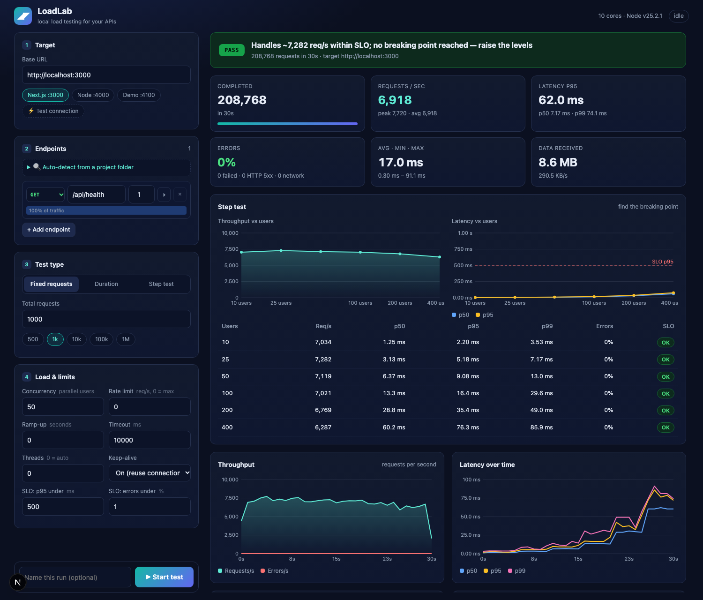

<div align="center">

# ⚡ LoadLab

**Send 500 → 1,000,000 requests to any API on your machine and see exactly how it holds up.**

Live throughput · latency percentiles · errors per endpoint · a pass/fail verdict · plain-English suggestions




</div>

---

## What is this?

LoadLab is a small web app you run **on your own computer**. You point it at another app that is also running on
your computer (a Next.js app, an Express API, a microservice…), tell it how many requests to send, and it shows you:

- how many requests per second your app can answer,
- how long users wait (p50 / p95 / p99),
- which endpoints are slow or failing,
- **where your app starts to struggle** (Step test),
- and **why** a test failed, with suggestions for fixing it.

It is a single Next.js project (UI + API together), written in JavaScript, with **no database** and **no extra
runtime dependencies** besides `next`, `react` and `react-dom`.

> **Who is it for?** Developers who want to know "can my API handle this?" before they ship, without setting up k6,
> JMeter or a cloud service.

---

## Table of contents

1. [Quick start](#quick-start)
2. [Your first test (5 minutes)](#your-first-test-5-minutes)
3. [The three test types](#the-three-test-types)
4. [All settings explained](#all-settings-explained)
5. [Understanding the results](#understanding-the-results)
6. [Auto-detect endpoints](#auto-detect-endpoints)
7. [Dynamic values in requests](#dynamic-values-in-requests)
8. [Run history and comparing runs](#run-history-and-comparing-runs)
9. [Safety](#safety)
10. [How it works](#how-it-works)
11. [HTTP API](#http-api)
12. [Limits](#limits)
13. [Troubleshooting](#troubleshooting)
14. [Tips for trustworthy numbers](#tips-for-trustworthy-numbers)
15. [FAQ](#faq)

---

## Quick start

**You need:** [Node.js](https://nodejs.org) **20.9 or newer**. Nothing else (no Docker, no database).

```bash
git clone <this-repo-url> loadlab
cd loadlab
npm install
npm run dev
```

Open **http://localhost:5050**.

For a faster, production-style run of LoadLab itself:

```bash
npm run build
npm start          # also http://localhost:5050
```

### No app to test? Use the built-in demo target

```bash
npm run demo-target      # starts a practice API on http://localhost:4100
```

| Path | Behaviour |
|---|---|
| `/fast` | answers instantly |
| `/slow` | takes about 100–140 ms |
| `/cpu` | burns CPU for ~8 ms (blocks the server, so it saturates quickly) |
| `/flaky` | fails with HTTP 500 about 10% of the time |
| `/echo` (POST) | returns the size of the body you sent |

In LoadLab click the **Demo :4100** chip and add a few of these paths. It is a safe way to learn what the results look like.

---

## Your first test (5 minutes)

1. **Start the app you want to test.** For the most realistic numbers use its *production* mode
   (for Next.js: `next build && next start`, not `next dev`).
2. **Open LoadLab** at http://localhost:5050.
3. **Target.** Type the base URL (for example `http://localhost:3000`) or click a preset chip, then press
   **⚡ Test connection**. A green ✓ means LoadLab can reach your app.
4. **Endpoints.** Choose what to hit:
   - type a path such as `/api/todos` and pick a method (GET, POST…), or
   - open **🔍 Auto-detect from a project folder**, pick your project, and tick the routes you want
     (see [Auto-detect endpoints](#auto-detect-endpoints)).
5. **Test type.** Start with **Fixed requests → 1k**.
6. Press **▶ Start test**. Numbers and charts update live every half second.
7. Read the **verdict banner** at the top and the **Analysis & suggestions** card at the bottom.

When that works, try a **Step test** (see below). It tells you how much your app can really take.

---

## The three test types

| Type | It stops when… | Use it to answer |
|---|---|---|
| **Fixed requests** (500, 1k, 10k, 100k, 1M, or your own number) | N requests have been sent | "Can my app handle exactly this much traffic?" |
| **Duration** (seconds) | the time is up | "Does it stay healthy for 5 minutes?" (finds slow leaks and degradation) |
| **Step test** | every level has run | "How many users can it handle before it breaks?" |

### Step test, in plain words

A Step test runs several short tests in a row, each with **more concurrent users** than the last:

```
levels: 10, 25, 50, 100, 200, 400      seconds per step: 15

 0s ───────15s ───────30s ───────45s ─── … ───────90s
   10 users    25 users    50 users            400 users
   measured    measured    measured            measured
```

Each step is a separate mini-test. You get one table row per level:

```
Users   Req/s    p95      Errors
  10    7,034    2.2 ms    0%    OK
  50    7,119    9.1 ms    0%    OK
 200    6,769   35.4 ms    0%    OK
 400    6,287   76.3 ms    0%    OK
```

**How to read it:** while *Req/s* keeps growing, your app still has spare capacity. When *Req/s* stops growing
but *p95* keeps climbing, you have found the bottleneck: extra users now only wait in line. The tool marks every
step as **OK** or **BREACH** against your SLO and tells you the highest level that still passed.

> In the table above, throughput is already flat at 10 users (~7,000 req/s), so this app is CPU-bound on a single
> process: more users only add waiting time (p95 grows from 2 ms to 76 ms) but never more throughput.

Users join **gradually** inside each step (the *Ramp-up* setting, default ≈ 3 s) because real users never arrive in
the same millisecond. Without this, hundreds of brand-new connections at the same instant can overflow the
operating system's connection queue and cause errors that say nothing about your app.

---

## All settings explained

### 1. Target
| Field | Meaning |
|---|---|
| **Base URL** | Where your app runs, e.g. `http://localhost:3000`. Endpoint paths are added to it. |
| **Test connection** | Sends one request to the first endpoint to check it is reachable. |

### 2. Endpoints
Each row is one request type.

| Field | Meaning |
|---|---|
| **Method / path** | e.g. `GET /api/todos`. A full `http://…` URL also works. |
| **Weight** | How much of the traffic this endpoint gets. Weights `3` and `1` = 75% / 25%. The bar below each row shows the share. |
| **▸ (expand)** | Add **headers** (`Authorization: Bearer …`, one per line) and a **JSON body** for POST/PUT/PATCH. |

### 3. Test type
See [The three test types](#the-three-test-types). Step test adds **Concurrent users per step** (comma separated) and **Seconds per step**.

### 4. Load & limits
| Field | Meaning | Example |
|---|---|---|
| **Concurrency** | How many virtual users send requests at the same moment. Each user sends a request, waits for the answer, then immediately sends the next. *(hidden in Step test, where the levels set it)* | `50` |
| **Rate limit** (req/s) | Caps the **total** requests per second. `0` = as fast as possible. | `500` = "hold a steady 500/s" |
| **Ramp-up** (seconds) | Users start gradually instead of all at once. In a Step test it is *per step*; `0` = automatic. | `3` |
| **Timeout** (ms) | A request with no answer by then counts as failed (`TIMEOUT`). | `10000` |
| **Threads** | Worker threads that generate load. `0` = auto (up to 4, depending on your CPU). Raise it if the tester itself becomes the bottleneck. | `0` |
| **Keep-alive** | **On**: reuse connections like a browser. **Off**: open a new TCP connection per request (tests connection handling; can exhaust ports at high volume). | On |
| **SLO: p95 under** (ms) | Your pass/fail rule for latency. | `500` |
| **SLO: errors under** (%) | Your pass/fail rule for failures. | `1` |

**Rate limit vs concurrency:**
- Rate limit `0` + many users = *"push as hard as you can and find my ceiling."*
- Rate limit `1000` = *"hold exactly 1,000 req/s and show me the latency."* (If your app can only answer 600, you will see ~600: a limit is a ceiling, not a promise.)

---

## Understanding the results

### The verdict banner
- **PASS**: p95 and error rate are within your SLO.
- **FAIL**: one of them is not. A **Why:** line explains the cause in plain words.
- **LIMIT FOUND** (Step test): some levels passed and then it broke. Shows the capacity and the breaking point.

### The numbers
| Metric | Meaning | Why you care |
|---|---|---|
| **Requests / sec** | Responses received per second (live, average and peak) | Your throughput / capacity |
| **p50** | Half of all requests were faster than this (the *median*) | The typical experience |
| **p90 / p95** | 90% / 95% of requests were faster than this | What slower users see |
| **p99** | 99% were faster; only 1 in 100 was worse | The unlucky users: where problems show up first |
| **Errors** | HTTP 5xx responses + network failures (timeouts, resets, refused connections) | Whether the app breaks under load |
| **Avg / min / max** | Mean, fastest and slowest request | Averages hide outliers, so prefer percentiles |

> **"p" means percentile.** `p95 = 40 ms` means *95 out of 100 requests finished in under 40 ms.*
> p50 is **not** the lowest and p95 is **not** the highest. They are points along the sorted list of all request times.

A useful rule of thumb: **latency ≈ concurrent users ÷ requests per second**. 400 users at 6,650 req/s means each
request waits about 60 ms. That is queueing, not slow code, and it means the server is at its throughput ceiling.

### Error types
4xx responses are shown in the status breakdown but are **not** counted as failures. Only 5xx and network errors are.

| Error | What it means |
|---|---|
| `ECONNRESET` | The server (or OS) closed the connection while the request was in flight. Typical when too many connections arrive at once, or the process crashed/restarted. |
| `EPIPE` | We tried to send on a connection the server had already closed. |
| `ECONNREFUSED` | Nothing accepted the connection: the app is down, wrong port, or its queue is full. |
| `TIMEOUT` | No answer within the timeout: the server is overloaded or blocked. |
| `EADDRNOTAVAIL` / `EMFILE` | The **tester's** machine ran out of ports / open files, not your server's fault. |

### Charts
- **Throughput**: requests per second, and errors per second, over time.
- **Latency over time**: p50 / p95 / p99 per second. A line that climbs during the run means something is degrading.
- **Latency distribution**: how many requests fell into each speed bucket (log scale) with p50/p95/p99 marked.
- **Responses**: status codes (200, 500…) and network errors, each explained.
- **Step test charts**: throughput vs users and latency vs users (with your SLO as a dashed line).

### Analysis & suggestions
After every run LoadLab applies rules to the data and lists findings, most severe first. Examples:

- **Why this run failed**: e.g. *"a connection burst at the start"* vs *"errors throughout the run"*.
- Connection refused · timeouts · dropped connections · 5xx errors · rate limiting (429) · auth failures · many 404s.
- Heavy latency tail (p99 ≫ p50) · requests queueing (server saturated) · latency climbing during the test · throughput decaying.
- Slowest endpoints · endpoints with errors · very large or uncompressed responses.
- Next.js detected: reminder to benchmark the production build.
- Step test: sustainable capacity, breaking point, and whether throughput collapses under overload.
- The load generator itself struggling (so you don't trust inflated numbers).

Each finding has a **How to improve** hint.

---

## Auto-detect endpoints

Open **🔍 Auto-detect from a project folder**, click one of the project chips (sibling folders that contain a
`package.json`) or paste a path, then **Scan**. LoadLab reads your source files (it never runs them) and finds:

| Framework | What it detects |
|---|---|
| **Next.js (app router)** | `app/**/route.js|ts`, and which of GET/POST/PUT/PATCH/DELETE each file exports |
| **Next.js (pages router)** | `pages/api/**` (method assumed GET) |
| **Express / Fastify-style** | `app.get('/path')`, `router.post('/path')`, … |

Dynamic segments (`[id]`, `:id`) are replaced by `1`. Edit them to a real id, or use a [placeholder](#dynamic-values-in-requests).
Tick the routes you want and press **Add selected**. POST/PUT/PATCH rows get a sample JSON body that you should adjust.

---

## Dynamic values in requests

Use these in paths, header values and bodies. A fresh value is generated **for every request**:

| Placeholder | Becomes |
|---|---|
| `{{uuid}}` | a random UUID |
| `{{int}}` / `{{int:1000}}` | a random integer (below 1000 in the second form) |
| `{{rand:8}}` | 8 random hex characters |
| `{{ts}}` | the current timestamp in milliseconds |
| `{{pick:a\|b\|c}}` | one of the listed options at random |

Example body for creating items without duplicates:

```json
{ "title": "load test {{uuid}}", "completed": false }
```

Example path that spreads reads across ids: `/api/todos/{{int:500}}`

> ⚠️ POST/PUT/PATCH/DELETE requests **change real data** in whatever database your app uses. Use a development database.

---

## Run history and comparing runs

Every finished run is saved and listed under **History**:

- **Click a run** to reopen its full results.
- **↺** loads that run's settings back into the form so you can repeat it.
- **×** deletes it.
- **Tick two runs** to see a side-by-side comparison with percentage changes (green = better, red = worse). This is
  how you check whether an optimization actually helped.

You can also deep-link to a run: `http://localhost:5050/?run=<run-id>`.

Runs are stored as JSON files in `data/runs/` (the latest 100 are kept). Your form settings are remembered in the
browser. There is no database.

---

## Safety

LoadLab can generate a lot of traffic, so it is locked down by default:

- **Localhost by default.** Requests to any other host are rejected (`localhost`, `127.x.x.x`, `::1`, `0.0.0.0`,
  `*.localhost`, `host.docker.internal`). A templated host like `http://{{pick:…}}/` cannot bypass the check.
- **External sites need your explicit approval, per domain.** Type the site as the Base URL, tick *"I own this site
  (or have permission to load-test it)"* and press **Allow this site**. The approval is stored in
  `data/allowed-hosts.json` (git-ignored) and can be removed any time. `example.com` and `www.example.com` are
  separate domains and must be approved separately.
- **Approved external sites have lower limits:** up to **100 users**, **100,000 requests** or **5 minutes** per test,
  because hosted sites hit quotas and bot protection quickly. TLS certificates are verified for external sites.
  To lift the caps for systems you fully control, start with `ALLOW_REMOTE=1 npm run dev`.
- **Only test systems you own or have permission to test.** Load-testing someone else's site can be illegal, and even
  on your own hosting (Vercel, Netlify, Cloudflare…) heavy automated traffic can use up quotas or get you blocked.
- **Bound to 127.0.0.1.** Other devices on your network cannot open the dashboard.
- **The API only answers the dashboard.** Requests whose `Host` isn't a loopback address, or whose `Origin` doesn't
  match, get `403`. This blocks DNS-rebinding and other websites in your browser from controlling the tool.
- **One test at a time**, and hard [limits](#limits) on size.
- The project scanner only reads source files and returns route paths, not file contents.

---

## How it works

```
 Browser (React dashboard)
      │  POST /api/runs            start a test
      │  GET  /api/runs/:id/events live updates (Server-Sent Events, every 0.5 s)
      ▼
 Next.js route handlers ──► Engine (orchestrator)
                                 │ splits the work
                                 ▼
                      Worker threads  ×  N   ──► HTTP requests ──► your app
                                 │
                                 └─ every 250 ms: send counts + latency histogram back
```

1. **Validate** the settings and check the target is local.
2. **Plan phases**: a normal run is one phase; a Step test is one phase per user level.
3. **Spawn worker threads.** Concurrency, request count and rate limit are divided between them.
4. Each virtual user is a loop: *pick an endpoint by weight → send the request → wait for the full response →
   record time, status and bytes → repeat.* Users start staggered by the ramp-up.
5. **Measure** each request with a high-resolution clock. Latencies go into a log-scale histogram (520 buckets,
   each 3% wider than the last, so percentiles are accurate to about 3% while memory stays tiny).
6. **Merge** worker updates, build a per-second timeline, and push snapshots to the browser.
7. **Analyze** the final data and produce the verdict and suggestions.

### Project layout

```
app/                  Next.js app router: page, layout, global CSS
  api/                state · probe · scan · runs (+ [id], stop, events)
components/           Dashboard, ConfigPanel, Results, History, Charts (canvas), format helpers
engine/
  engine.js           config validation, phases, aggregation, timeline, snapshots
  worker.js           load-generating worker thread (HTTP loop, pacing, ramp-up)
  analyze.js          verdict + suggestions rules
  hist.js             latency histogram + percentiles
  scan.js             Next.js / Express route detection
lib/                  store (live runs + JSON history), request guard
scripts/demo-target.js  practice API
data/runs/            saved run history (git-ignored)
```

---

## HTTP API

Everything the UI does goes through a small JSON API (handy for scripts and CI). All calls must come from a loopback host.

| Method & path | Purpose |
|---|---|
| `GET /api/state` | Active run id, history list, system info, sibling project folders |
| `GET /api/probe?url=…` | Send one test request and report status / time |
| `POST /api/scan` `{ "dir": "/path/to/project" }` | Detect routes in a project |
| `POST /api/runs` | Start a run → `201 { "id": "…" }` (`409` if one is already running) |
| `GET /api/runs/:id` | Live snapshot, or the final result with analysis |
| `GET /api/runs/:id/events` | Server-Sent Events: `config`, `snapshot` (≈2/s), then `end` with the full result |
| `POST /api/runs/:id/stop` | Stop a running test |
| `DELETE /api/runs/:id` | Delete a finished run |

Start a run from the command line:

```bash
curl -X POST http://localhost:5050/api/runs \
  -H 'content-type: application/json' \
  -d '{
    "name": "todos smoke test",
    "base": "http://localhost:3000",
    "mode": "requests",
    "total": 10000,
    "concurrency": 50,
    "endpoints": [
      { "method": "GET",  "path": "/api/todos", "weight": 4 },
      { "method": "POST", "path": "/api/todos", "weight": 1,
        "body": { "title": "load {{uuid}}" } }
    ]
  }'
```

Fields: `name`, `base`, `mode` (`requests` | `duration` | `steps`), `total`, `durationSec`, `concurrency`, `rps`,
`rampSec`, `timeoutMs`, `thinkMs`, `keepAlive`, `threads`, `steps: { levels: [10, 50, 100], secondsPerStep: 15 }`,
`slo: { p95Ms: 500, errorPct: 1 }`, and `endpoints: [{ method, path, weight, headers, body }]`.

Then poll `GET /api/runs/<id>` until `state` is `done`, and read `analysis.verdict.status`.

---

## Limits

| Setting | Allowed range |
|---|---|
| Total requests | 1 – 10,000,000 |
| Concurrency | 1 – 5,000 |
| Duration | 1 – 3,600 s |
| Step levels | up to 12 levels, 2 – 600 s each |
| Threads | 1 – 16 |
| Timeout | 100 – 120,000 ms |
| Rate limit | 0 (unlimited) – 5,000,000 req/s |
| Endpoints | up to 200 |
| History kept | latest 100 runs |

On a modern laptop LoadLab can send **well over 100,000 requests per second** to a trivial endpoint
(a 1,000,000-request test finished in under 10 seconds in our testing).

---

## Troubleshooting

| Symptom | Likely cause and fix |
|---|---|
| **"… is an external site"** | The target isn't localhost. Under Target, tick the ownership box and press **Allow this site**. |
| **Test shows 100% `301/302/307`** | The URL redirects (e.g. `example.com` → `www.example.com`). LoadLab doesn't follow redirects; use the final URL. |
| **`403` / `429` on a hosted site** | A firewall or bot protection is rate-limiting you. Lower the load; don't bypass it. |
| **Test connection says "Connection refused"** | Your app isn't running, or it's on another port. Check with `lsof -iTCP:3000 -sTCP:LISTEN`. |
| **Lots of `ECONNRESET` / `EPIPE` in the first seconds** | Hundreds of new connections arriving at once overflowed the OS connection queue. Use **Ramp-up**. On macOS the queue is small by default (`sysctl kern.ipc.somaxconn`). |
| **`EMFILE` / `EADDRNOTAVAIL`** | The tester ran out of file descriptors / ports. Leave Keep-alive **On**, lower concurrency, or `ulimit -n 65535`. |
| **Many `TIMEOUT`** | The server is overloaded or blocked. Lower the load or find the slow endpoint in the per-endpoint table. |
| **100% errors** | Wrong base URL/port, or the app crashed. Run **Test connection** first. |
| **Results far worse than expected on Next.js** | You are testing `next dev`. Use `next build && next start`. |
| **A run finished instantly with 0 requests** | Check the target and endpoint paths; a 404-only run is flagged in the analysis. |
| **"A test is already running"** | Only one test runs at a time. Press **Stop test**. |
| **Port 5050 is in use** | `npx next dev -p 5051 -H 127.0.0.1` (or `next start -p 5051 -H 127.0.0.1`). |

---

## Tips for trustworthy numbers

- **Test the production build** of your app, not the dev server.
- **Warm up first.** Run a small test before the real one, or use Ramp-up, so JIT and caches don't skew results.
- **Watch p95/p99, not the average.** A few slow requests hide inside a good average.
- **Run long enough.** 10–15 s per step minimum; use **Duration** for several minutes to catch leaks.
- **Close heavy apps.** The tester and your app share your CPU. At very high request rates your measured capacity is a
  *lower bound*; a separate machine would show more. LoadLab warns you when its own workers lag.
- **Repeat important tests** and compare runs in History. One run can be noisy.
- **Use a dev database**; write requests (POST/PUT/PATCH/DELETE) create and change real rows.
- **Don't send load-test traffic to real analytics or logging projects.**

---

## FAQ

**Does it work with any language?** Yes. It speaks plain HTTP/HTTPS, so the target can be Next.js, Express,
Django, Rails, Go, Spring… as long as it listens on a local port. The auto-detect scanner understands Next.js and
Express-style projects; for others, type the endpoints in by hand.

**Is it a replacement for k6 / JMeter / wrk?** It covers the common case ("how much can my local API take, and where
does it break?") with a UI and explanations. For distributed load, complex scripted user journeys, or testing remote
production systems, use a dedicated tool.

**Does it support WebSockets, GraphQL subscriptions, or file uploads?** Not currently. It sends HTTP requests with
optional headers and a text/JSON body. GraphQL queries over POST work.

**Does it store my data in a database?** No. Run history is JSON files in `data/runs/`, and form settings live in
your browser.

**Why is p50 lower than the average?** A few very slow requests pull the average up. The median ignores them. That is
exactly why percentiles are more informative than averages.

**Can I script it in CI?** Yes, use the [HTTP API](#http-api): start a run, wait for `state: "done"`, and fail the build
if `analysis.verdict.status` is `FAIL`.

---

<div align="center">

Built with Next.js · Everything runs locally · Only test systems you own

</div>
